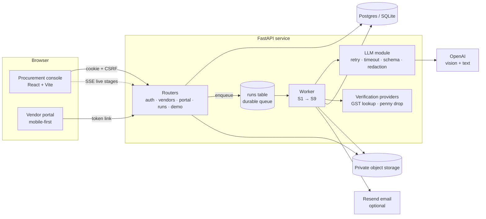

# Vendor Onboarding

Checks a new supplier's company, tax and bank details before you ever pay them. It then decides
**Approved**, **Waiting on vendor** or **Rejected**, shows the reasoning, and tells the vendor exactly what is still needed.

Built for a fictional mid-size Indian manufacturer, *Acme Industries Pvt Ltd* (the name is one setting).

---

## For the buyer: what it does

**The problem.** Before paying a new supplier, someone in procurement has to confirm the supplier is real and that the money goes to *their* bank account. Today that means:
- reading PDFs by eye;
- comparing the GST certificate, PAN card and cancelled cheque against the form;
- chasing the vendor by email;
- the only record of any of it is someone's inbox.

Mistakes here mean payment fraud or compliance trouble.

**What this does instead.**

1. A buyer creates a request, and the vendor gets a private link.
2. The vendor fills one form on their phone or laptop and uploads three documents.
3. The system checks everything in under a minute:
   - **Reads the documents** with an AI model and confirms each one is what it claims to be. A PAN card uploaded as a GST certificate is caught.
   - **Checks formats** against Indian rules: PAN, GSTIN including its check digit, IFSC and PIN. It also checks US and UK tax IDs.
   - **Cross-checks fields that each look fine alone.** For example, the PAN embedded inside the GSTIN must be the vendor's PAN, and the GSTIN's state must match the address.
   - **Compares the names** on the GST certificate, PAN card and bank account. "Pvt Ltd" and "Private Limited" count as the same name; a person's name on a company's bank account does not.
   - **Looks for fraud:** a bank account or PAN already used by another vendor, and whether the bank confirms the account holder.
4. Fixed rules make the decision, not the AI, and every reason is listed.
5. If something is missing, the vendor gets an email listing **only** those items and fixes them through the same link. Everything they already gave is kept, and every check runs again.
6. Anything unclear goes to your team. An override needs a written reason **and a second admin's approval**.
7. Everything is recorded in a tamper-proof audit trail: who did what, when, and why.

**What you see.** A dashboard of every vendor and its status. A live view of each check as it runs. For each vendor: every attempt, every check with its reason, what the documents say next to what the vendor typed, every email sent, and the full audit trail.

---

## Demo

| | |
|---|---|
| Live URL | *Deploy with the steps below. The app runs fully locally in the meantime.* |
| Admin (maker) | `DEMO_ADMIN_EMAIL` / `DEMO_ADMIN_PASSWORD` from `.env` |
| Second admin (checker) | `DEMO_CHECKER_EMAIL` / `DEMO_CHECKER_PASSWORD` |
| Viewer (read-only) | `DEMO_VIEWER_EMAIL` / `DEMO_VIEWER_PASSWORD` |

Credentials are never in the code. The seed script reads them from the environment.

### Scenarios (Demo scenarios page, one click each)

| Scenario | What happens | Expected |
|---|---|---|
| **Happy path**: Sharma Hardware Pvt Ltd, Delhi | Everything agrees; the bank reads "SHARMA HARDWARE PRIVATE LIMITED" and normalisation matches it | **Approved**, added to vendor master |
| **E1 Silent inconsistency**: Kaveri Polymers | Every field is valid alone, but the GSTIN contains a different PAN and is registered in Maharashtra while the address is in Delhi | **Rejected**, with both reasons |
| **E2 Wrong document + missing item**: Deccan Raw Materials | PAN card uploaded as the GST certificate, no cancelled cheque | **Waiting on vendor**; the email asks for exactly those two. Then "Vendor resubmits fix" → attempt 2 → **Approved** |
| **E3 Personal bank account**: Ganga Freight Carriers | Account holder is "Rakesh Kumar", not the company | **Rejected**: third-party payment risk |
| **E4 Duplicate bank account**: Orion Fasteners | Uses the account of an already-approved vendor | **Rejected**, linking to that vendor |
| **E5 Prompt injection**: Nimbus Packaging | The GST certificate hides text telling the AI to approve | Flagged, ignored, **Rejected** (invalid GSTIN) |
| **E6 Wrong tax ID for country**: Thames Precision (UK) | An Indian GSTIN typed as a UK VAT number | **Waiting on vendor** |

The dashboard is pre-seeded with 11 historical vendors across every status.
All companies, people, IDs and banks are fictional. See [sample_data/README.md](sample_data/README.md).

---

## For engineers

### Architecture



### The pipeline

| Stage | Kind | What it does |
|---|---|---|
| S1 Intake | code | Redacted snapshot of the submission and file hashes |
| S2 Document understanding | **LLM (vision)** | PDF pages → images (PyMuPDF). Classify + extract each document **in parallel** with Structured Outputs, re-validated by Pydantic, with per-field confidence. Flags embedded instructions. |
| S3 Completeness | code | Required fields and documents per country; right document in the right slot |
| S4 Format | code | PAN, GSTIN regex **+ checksum**, IFSC, PIN, country tax-ID rules from `config/countries.yaml` |
| S5 Consistency | code | PAN inside GSTIN, GSTIN state vs address, extracted vs typed values |
| S6 Name matching | code → **LLM** | Normalise first; only unresolved pairs go to the model (SAME / DIFFERENT / UNSURE). UNSURE → human. |
| S7 Risk | code | Duplicate account / PAN in vendor master, free-mail domain, GST lookup, penny drop |
| S8 Decision | code | BLOCKING → Rejected; FIXABLE → Waiting on vendor (or closed at attempt 3); NEEDS_REVIEW → internal review; else Approved |
| S9 Communication | **LLM** + code | The model drafts the opening and closing; code inserts the exact fix-list and link. Template fallback. |

LLM failures (timeout, error, invalid JSON) get one retry, then the item goes to manual review. A run never crashes and never auto-approves.

### Project layout

```
backend/
  app/
    pipeline/      s1_intake.py … s9_communication.py, decision.py, runner.py
    validators/    india.py (PAN, GSTIN checksum, IFSC, PIN), tax_ids.py, names.py
    llm/           client.py (the only LLM entry point), schemas.py, mock.py
    security/      sessions.py, passwords.py, crypto.py
    routers/       auth, vendors, portal, runs (SSE), demo
    verification/  providers.py (GST lookup, penny drop)
    worker.py      durable queue
    seed.py        demo users + history
  config/          countries.yaml, states.yaml
  prompts/         classify_extract.md, name_match.md, draft_message.md
  migrations/      Alembic
  tests/           97 tests
frontend/src/
  routes/          Dashboard, VendorDetail, RunLive, Runs, Outbox, Demo, Portal, Login
  components/      AppShell, StageList, badges, ui/ (shadcn-style, custom tokens)
sample_data/       generate.py, docs/, scenarios.json, manifest.json
```

### Run locally

Requirements: Python 3.11, Node 22.

```bash
cp .env.example .env          # fill FERNET_KEY, HMAC_KEY, OPENAI_API_KEY, DEMO_* (commands are in the file)
make setup                    # venv + npm ci
make seed                     # migrations, demo users, 11 historical vendors
make api                      # http://localhost:8000  (API + worker)
make web                      # http://localhost:5173  (dev UI, proxies /api)
```

Or a production-like single server: `make build && make api`, then open http://localhost:8000 (set `PUBLIC_APP_URL=http://localhost:8000`).

No OpenAI key? Set `LLM_MODE=mock`. Everything works offline with deterministic answers for the sample documents.

```bash
make test     # 97 tests, LLM mocked, ~7 s. Also passes against Postgres (TEST_DATABASE_URL=...)
make audit    # pip-audit + npm audit
make reset    # wipe and reseed the demo data
```

### Deploy

The `Dockerfile` builds the frontend and serves it from the API container: one public URL, same origin.

**Render** (blueprint in `render.yaml`) or **Railway** (`railway.json`):
1. Create a Postgres database on Neon or Supabase and copy its URL. `postgres://` URLs are converted automatically.
2. Create a private bucket for documents (S3, Cloudflare R2 or Supabase Storage) with an access key.
3. New service from this repo using the Dockerfile. Set these environment variables:

   | Variable | Value |
   |---|---|
   | `ENV` | `prod` |
   | `PUBLIC_APP_URL`, `FRONTEND_ORIGIN` | the service URL |
   | `DATABASE_URL` | from step 1 |
   | `FERNET_KEY`, `HMAC_KEY` | fresh values; never reuse dev keys |
   | `OPENAI_API_KEY` | your key |
   | `STORAGE_BACKEND` | `s3` |
   | `S3_BUCKET`, `S3_ENDPOINT_URL`, `S3_ACCESS_KEY_ID`, `S3_SECRET_ACCESS_KEY` | from step 2 |
   | `DEMO_*` | demo logins |
   | `RESEND_API_KEY` (optional) | to actually deliver emails |

4. Deploy. Startup runs migrations and the idempotent seed. Check `/health`.

**Frontend on Vercel (optional):** deploy `frontend/`, and in `frontend/vercel.json` replace `YOUR-BACKEND-HOST`. Vercel rewrites `/api/*` to the backend, so the browser stays on one origin and the strict cookies keep working.

**Keep it warm before a live demo:** free and starter instances sleep. Five minutes before, open `/health` (or `curl https://<host>/health` every few minutes), then run one scenario once so the model connection is warm.

### Quality

| | Mobile | Desktop |
|---|---|---|
| Lighthouse: dashboard (Perf / A11y / Best practices) | 98 / 100 / 100 | 100 / 100 / 100 |
| Lighthouse: vendor portal | 96 / 100 / 100 | 100 / 100 / 100 |

Measured on the production build served by FastAPI, locally.

- **Live LLM run times:** about 4–13 s per submission with `gpt-5.4` vision; all seven scenarios produce their expected outcome on the real model.
- **Initial JS:** about 125 KB gzipped, with route-level code splitting.
- **Responsive:** checked at 360, 375, 768, 1024 and 1440 px with no horizontal scroll. The sidebar becomes a drawer and tables become stacked rows on small screens.
- **Accessibility:**
  - Keyboard: skip link, visible focus, tabs with arrow-key support, native `<dialog>`.
  - Screen readers: labelled inputs, and `aria-live` announcements of each stage in the live run view.
  - Reduced motion is respected.

See [SECURITY.md](SECURITY.md) for the threat model and [ASSUMPTIONS.md](ASSUMPTIONS.md) for every judgment call.

---

## What I'd build next

1. **Real verification providers.** Plug a GSP's GSTIN public-search API and a penny-drop bank verification API into the existing provider interface. Add a live PAN–name match.
2. **MSME (Udyam) and sanctions/PEP screening** as extra S7 checks, plus TDS section mapping for the AP team.
3. **SSO + MFA** for the console (SAML/OIDC), and per-team roles beyond Viewer/Admin.
4. **Scheduled reminders and SLAs.** A cron job sends reminders and escalates cases stuck in internal review past a set number of days.
5. **Malware scanning** of uploads (ClamAV or a cloud scanner) before storage. Add signed short-lived download URLs.
6. **ERP sync.** Push approved vendors to the vendor master in SAP, Oracle or Tally. Re-verify bank details whenever a vendor asks to change them; a bank change is the riskiest moment.
7. **Evaluation set for the vision model.** A labelled set of real-world (consented) scans to track extraction accuracy per document type and tune the confidence threshold.
8. **Redis** for sessions and rate-limit counters once there is more than one instance.
